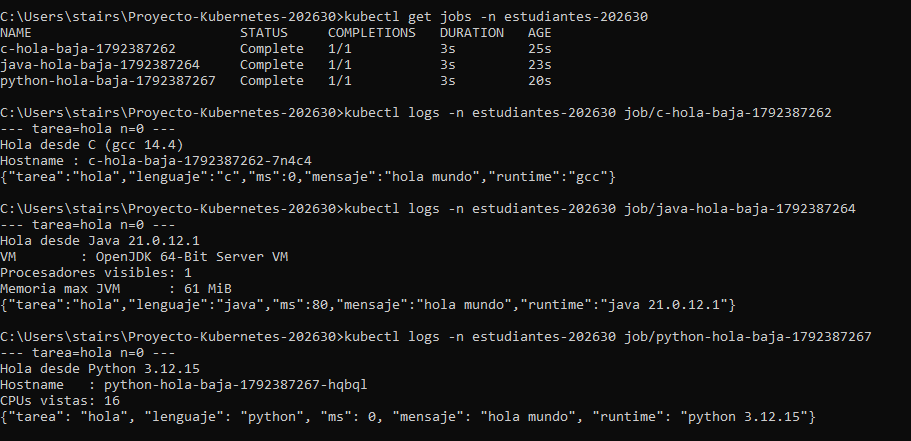
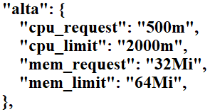
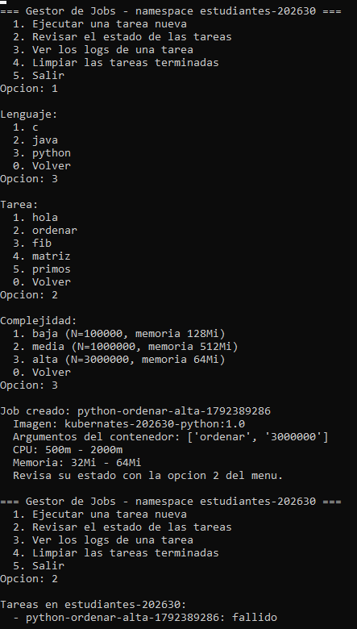
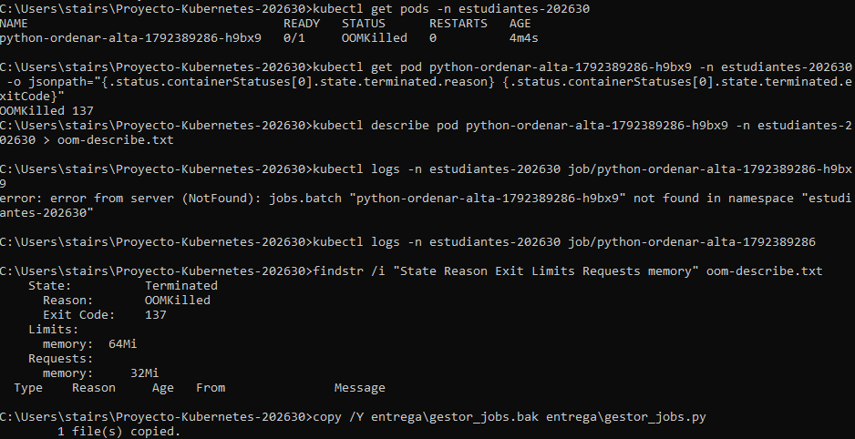
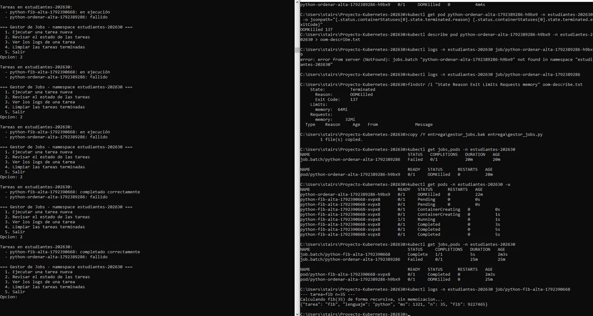
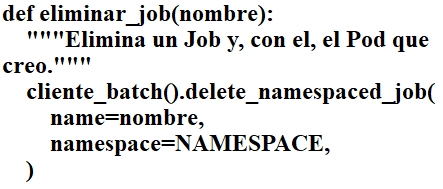
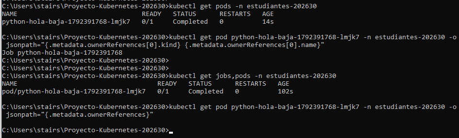

# Proyecto Kubernetes 202630: Jobs parametrizados desde línea de comandos

**Integrantes:**
- Camilo A. Acevedo
- Andrés Diaz
- Nicolas Arias

**Video de la demo:** [VER EN YOUTUBE]()

---

## 1. Qué hace el proyecto

`entrega/gestor_jobs.py` es un programa de menú en Python que crea y administra **Jobs de Kubernetes** usando el cliente oficial (`kubernetes`), sin invocar `kubectl`. El usuario elige lenguaje, tarea y complejidad, y Kubernetes ejecuta el contenedor correspondiente con los argumentos y recursos elegidos.

Recorrido completo:

```text
gestor_jobs.py -> Job de Kubernetes -> Pod -> contenedor con argumentos -> logs
```

Menú:

```text
=== Gestor de Jobs - namespace estudiantes-202630 ===
  1. Ejecutar una tarea nueva
  2. Revisar el estado de las tareas
  3. Ver los logs de una tarea
  4. Limpiar las tareas terminadas
  5. Salir
```

## 2. Estructura del repositorio

| Ruta | Contenido |
|---|---|
| `imagenes/{python,java,c}/` | Las tres imágenes. Reciben `<tarea> <N>`, escriben logs y cierran con un JSON de una línea |
| `catalogo/tareas.json` | Catálogo de lenguajes, imágenes y tareas admitidas |
| `k8s/00-namespace.yaml` | Namespace `estudiantes-202630` |
| `scripts/preparar-imagenes.sh` | Construye las imágenes dentro de Minikube (Linux/macOS) |
| `scripts/preparar-imagenes.ps1` | Lo mismo para Windows (PowerShell) |
| `entrega/gestor_jobs.py` | El gestor de Jobs (lo que construyó el grupo) |

## 3. Cómo ejecutarlo

Requisitos: Docker, Minikube, kubectl y Python 3.

**Linux / macOS**

```bash
minikube start --driver=docker
kubectl apply -f k8s/00-namespace.yaml
./scripts/preparar-imagenes.sh

python -m venv .venv
source .venv/bin/activate
pip install -r entrega/requirements.txt

python entrega/gestor_jobs.py
```

**Windows (PowerShell)**

```powershell
minikube start
kubectl apply -f .\k8s\00-namespace.yaml
.\scripts\preparar-imagenes.ps1

pip install -r .\entrega\requirements.txt
python .\entrega\gestor_jobs.py
```

Las imágenes se construyen **contra el demonio Docker de Minikube**, por eso hay que volver a ejecutar el script de preparación cada vez que se cambie el código de un contenedor. No se usa `minikube image load`, porque no reemplaza un tag que ya existe.

## 4. Implementación

### 4.1 Selección (`seleccionar`)

Lee el catálogo y muestra tres menús numerados: lenguaje, tarea (`definicion["tasks"]`) y complejidad. Devuelve la imagen declarada en el catálogo, los argumentos del contenedor (`[tarea, str(N)]`) y la fila de `NIVELES` del nivel elegido.

### 4.2 Creación del Job (`crear_job`)

Arma un objeto `V1Job` equivalente a este YAML y lo envía con `create_namespaced_job`:

```yaml
apiVersion: batch/v1
kind: Job
metadata:
  name: <nombre>
  namespace: estudiantes-202630
spec:
  backoffLimit: 0
  template:
    spec:
      restartPolicy: Never
      containers:
        - name: tarea
          image: <imagen>
          imagePullPolicy: Never
          args: [<tarea>, <N>]
          resources:
            requests: { cpu: <cpu_request>, memory: <mem_request> }
            limits:   { cpu: <cpu_limit>,   memory: <mem_limit> }
```

| Campo | Valor | Por qué |
|---|---|---|
| `imagePullPolicy` | `Never` | Las imágenes existen solo dentro de Minikube; Kubernetes no debe intentar descargarlas de un registro |
| `restartPolicy` | `Never` | Un Job es una ejecución única; si el contenedor termina, no se reinicia |
| `backoffLimit` | `0` | Si falla, no se reintenta: el Job queda en `Failed` y el error es visible |
| `requests` | CPU y memoria del nivel | Lo que el scheduler reserva para programar el Pod |
| `limits` | CPU y memoria del nivel | El tope: si se supera el de memoria el contenedor es terminado con `OOMKilled`; si se supera el de CPU, se frena |

En el cliente de Python los campos van en `snake_case` (`image_pull_policy`, `restart_policy`, `backoff_limit`) y en el YAML en `camelCase`.

### 4.3 Complejidad

La complejidad fija **dos cosas a la vez**: los recursos del Job (`NIVELES`) y el tamaño del trabajo, el valor de N (`TAMANOS`).

| Nivel | CPU (request / limit) | Memoria (request / limit) |
|---|---|---|
| baja | 100m / 500m | 64Mi / 128Mi |
| media | 250m / 1000m | 128Mi / 512Mi |
| alta | 500m / 2000m | 256Mi / 1Gi |

| Tarea | baja | media | alta |
|---|---|---|---|
| `hola` | 0 | 0 | 0 |
| `ordenar` | 100.000 | 1.000.000 | 3.000.000 |
| `fib` | 25 | 30 | 35 |
| `matriz` | 60 | 120 | 250 |
| `primos` | 1.000.000 | 10.000.000 | 50.000.000 |

### 4.4 Estado (`describir_estado`, `listar_jobs`)

Se lee el `status` del Job y se interpretan sus contadores (`active`, `succeeded`, `failed`, que valen `None` hasta que Kubernetes los fija):

| Situación | Estado mostrado |
|---|---|
| `active > 0` | en ejecución |
| `succeeded > 0` | completado correctamente |
| `failed > 0` | fallido |
| los tres en cero | pendiente (el Pod todavía no ha arrancado) |

### 4.5 Logs (`consultar_logs`)

Los logs pertenecen al **Pod**, no al Job. Kubernetes etiqueta cada Pod creado por un Job con `job-name=<nombre del Job>`, así que se busca el Pod con ese `label_selector` y se lee su log con `read_namespaced_pod_log(..., _preload_content=False)`. Con esa opción se recibe la respuesta sin procesar y se decodifica a UTF-8; sin ella, el cliente devuelve el `repr` de los bytes y los logs salen en una sola línea.

### 4.6 Limpieza (`jobs_terminados`, `eliminar_job`)

Un Job está **terminado** si no tiene Pods activos y tiene al menos uno correcto o fallido, por lo que la limpieza nunca cancela trabajo en ejecución. Antes de borrar se pide confirmación.

El borrado usa `propagation_policy="Background"`, que hace que Kubernetes elimine también los Pods del Job. Sin esa opción el Job desaparece pero su Pod queda huérfano en el namespace.

## 5. Tarea adicional: `primos`

Cuenta cuántos números primos hay hasta N con la **criba de Eratóstenes**, en Python (`imagenes/python/tareas.py`). Devuelve la cantidad y el último primo encontrado.

Cambios realizados:
1. Función `primos` y registro en el diccionario `TAREAS` de `tareas.py`.
2. `"primos"` añadido a la lista de tareas de `python` en `catalogo/tareas.json`.
3. Fila `primos` en la tabla `TAMANOS` del gestor.
4. Imagen reconstruida con `scripts/preparar-imagenes.sh`.

Verificación con valores conocidos de π(N):

| Nivel | N | Cantidad de primos |
|---|---|---|
| baja | 1.000.000 | 78498 |
| media | 10.000.000 | 664579 |
| alta | 50.000.000 | 3001134 |

## 6. Pruebas y hallazgos

> COMPLETAR con lo observado por el grupo.

- **Comparación de `hola` entre lenguajes:** (tiempos de arranque en Python, Java y C; qué se nota de la JVM).
Con `hola` en complejidad baja, los tres Jobs duraron 3 s, porque Kubernetes mide el Pod completo (creación y arranque) y solo en segundos enteros. La diferencia está en el campo `ms` del log: C y Python marcaron 0 ms y Java 80 ms, coherente con el arranque de la JVM. Además, Java ve los límites del contenedor (1 CPU, 61 MiB de heap), mientras que Python reporta las 16 CPU del nodo.

   
  
- **Prueba de `OOMKilled`:** (qué `mem_limit` se usó, con qué tarea, y qué mostró `kubectl describe pod`).
Al bajar la memoria del nivel `alta` (request 32Mi, limit 64Mi) y ejecutar `ordenar` en Python con N=3.000.000, el Pod terminó con `Reason: OOMKilled` y `Exit Code: 137` (128 + SIGKILL). No se reinició (`RESTARTS 0`, por `restart_policy="Never"` y `backoff_limit=0`), el Job quedó fallido y el log salió vacío porque el proceso murió antes de imprimir. El límite de memoria es un tope duro: superarlo mata el contenedor, mientras que el de CPU solo lo frena. Se restauraron los valores originales.

   
   
   
  
- **Pods huérfanos:** (qué pasó al borrar el Job sin `propagation_policy`).
Los estados del menú coinciden con `kubectl get jobs,pods`: `python-fib-alta` pasó de "en ejecución" a "completado correctamente" mientras su Pod recorría `Pending`, `ContainerCreating`, `Running` y `Completed` (unos 5 s), y `ordenar` figura como "fallido" y `Failed 0/1`. Hay tres diferencias: (1) el menú no distingue las fases del Pod, porque se basa en los contadores del Job; (2) un Job fallido aparece solo como "fallido", mientras que `kubectl get pods` revela la causa (`OOMKilled`); (3) el DURATION de `kubectl` para un Job fallido sigue creciendo (20 m, luego 25 m) aunque el Pod murió en segundos, porque el Job nunca registra hora de finalización.

   
  
- **Contraste con el clúster:** lo que muestra el menú coincide con `kubectl get jobs,pods -n estudiantes-202630`.
Al quitar `body=client.V1DeleteOptions(propagation_policy="Background")` de `eliminar_job`, el Job se eliminó pero su Pod (`python-hola-baja-1792391768-lmjk7`) siguió en estado `Completed` y su `ownerReferences`, que antes apuntaba al Job, quedó vacío: un Pod huérfano que nada eliminará. Con la política original, Job y Pod desaparecían juntos, y por eso `eliminar_job` usa `Background`. Se restauró el código original.

   
   
